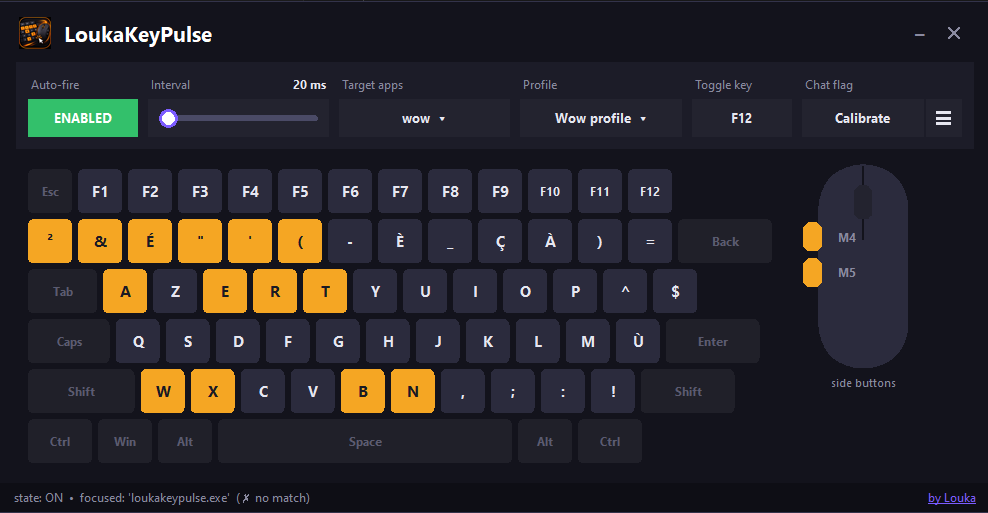
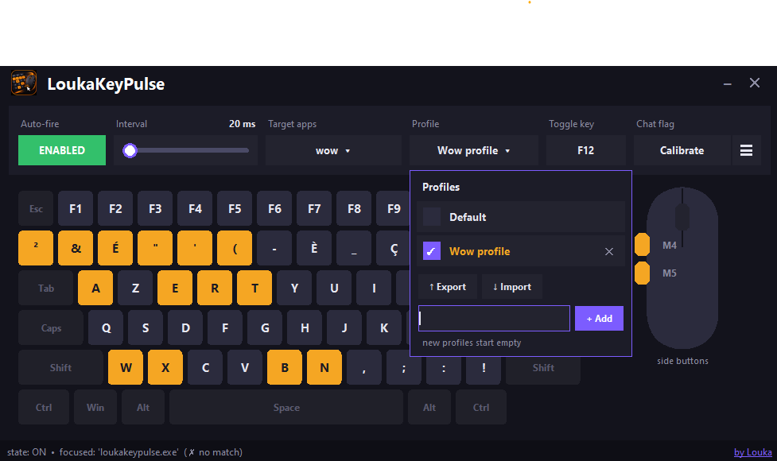
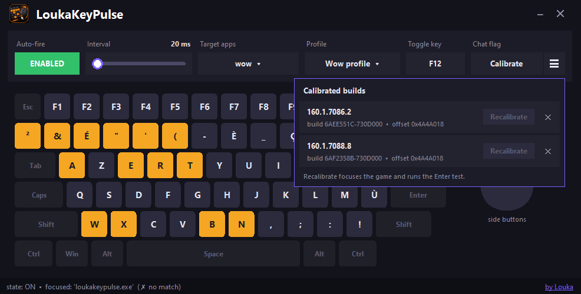

# LoukaKeyPulse

LoukaKeyPulse is a small Windows tool that repeats keyboard presses and mouse side-button clicks at an interval you choose while you hold the key. It has per-game profiles, a system tray mode, and an optional WoW feature that pauses it while the chat box is open.

Copyright (c) 2026 Malek Mzali (Louka). All rights reserved. Free to use, not free to modify. See [LICENSE](LICENSE).

## Features

- Pick any key on the on-screen keyboard, or the mouse side buttons M4 and M5, and it repeats while you hold the real key.
- Interval from 1 ms to 500 ms with the slider. Click the number to type an exact value, up to 5000 ms.
- Per-key modifier rules: choose whether Shift, Ctrl or Alt turn the repeat off for that key.
- Target apps: repeat only in the apps you choose. With none selected it works in every window.
- Profiles with export and import to a JSON file.
- Global toggle key (F12 by default) to switch auto-fire on and off.
- Hides to the system tray on close. Right-click the tray icon for Show and Quit.
- Only one copy can run at a time. Starting a second copy brings the first one back.
- Automatic updates: the app checks GitHub Releases, shows the changelog, and lets you choose Update now, Later or Skip this version.
- **WoW chat pause:** auto-fire stops by itself while you type in chat, so your messages come out normally.
  - Each WoW client build needs a one-time setup with the **Calibrate** button. Your setups are saved per build.
  - The menu button next to it lets you redo or delete a saved setup.
  - The tool only reads WoW's memory. It never changes it, and it never touches other programs.
## Screenshots

### Main window

### Profiles

### Calibrated builds


## Requirements

- Windows 10 or 11
- Python 3.10 or newer, only if you run from source
- Run as administrator if the game runs as administrator. Windows blocks input sent to a higher-privilege window.

## Run from source

```
python main.py
```

or

```
python -m loukakeypulse
```

The app uses only the Python standard library.

## Build the exe
1. Run `build.bat`.
2. Your build is in `dist\LoukaKeyPulse.exe`.

The build settings are at the top of `LoukaKeyPulse.spec`:

- `ADMIN = True` asks for administrator on launch.
- `ONEFILE = True` builds a single exe. Set it to `False` for a folder build that starts faster.

## Using it

1. Click a key on the on-screen keyboard to add it. Click it again for its modifier rules, or to remove it.
2. Set the interval with the slider, or click the number to type it.
3. Choose target apps, or leave it on Any window.
4. Press the toggle key to enable auto-fire, then hold a chosen key in your game.
5. For WoW, start the game, enter the world with the chat box closed, and click Calibrate once for each client build. Keep your hands off the keyboard while it runs.

## Updates

- A few seconds after start, and then at most every 6 hours, the app asks GitHub for the latest release. If you are offline it stays silent.
- When a newer version exists a window shows the changelog with three choices: Update now, Later (asks again next launch), or Skip this version.
- Update now downloads the new exe, checks its SHA-256 against the published checksum, swaps it in, and restarts. When running from source it opens the download page instead.
- Right-click the tray icon and choose Check for updates to check on demand.
- Downloads are only accepted from github.com hosts over HTTPS.

4. The workflow in `.github/workflows/release.yml` builds `LoukaKeyPulse.exe`, creates its `.sha256` file, publishes the GitHub release with your notes, and posts to Discord if a webhook is configured.

One-time setup: set `GITHUB_REPO` in `loukakeypulse/updater.py` to your repository, make sure the releases are public, and optionally add a Discord webhook URL as a repository secret named `DISCORD_WEBHOOK`.

## Project layout

```
main.py                  entry point
loukakeypulse/
  app.py                 startup
  engine.py              keyboard and mouse hooks, repeat thread
  wowchat.py             chat detection and calibration
  ui.py                  main window
  ui_keys.py             keyboard view and key popups
  ui_profiles.py         profiles, import and export
  ui_targets.py          target app picker
  ui_calibration.py      calibration manager
  ui_update.py           update window
  updater.py             update check, download and install
  winapi.py              Windows API declarations
  winutil.py             window and process helpers
  keyinput.py            sending input
  keymap.py              keyboard layout helpers
  state.py               shared state
  config.py              settings storage
  tray.py                system tray icon
  singleton.py           single instance check
  imaging.py             icon helpers
  theme.py               colors and sizes
tools/                   version info and release notes scripts
.github/workflows/       automatic release build
CHANGELOG.md             release history
LoukaKeyPulse.spec       PyInstaller build recipe
version_info.txt         exe version details
build.bat                build script
```

## Settings location

`%APPDATA%\LoukaKeyPulse\loukakeypulse.json` holds your profiles and saved calibrations. If you used the earlier LoukaSpammy, its settings are copied over on first launch.

## Notes

- Antivirus programs sometimes flag tools that use keyboard hooks, simulated input and memory reading, even when they are harmless. If your exe is flagged, try the folder build (`ONEFILE = False`) and add an exclusion for it.
- Some games and anti-cheat systems ignore or block simulated input. Check the rules of any game before using this tool. You use it at your own risk.

## License

LoukaKeyPulse Freeware License (No Modifications). You may use it and share unmodified copies for free. You may not modify it, sell it, or remove the copyright notices. Read the full text in [LICENSE](LICENSE).
